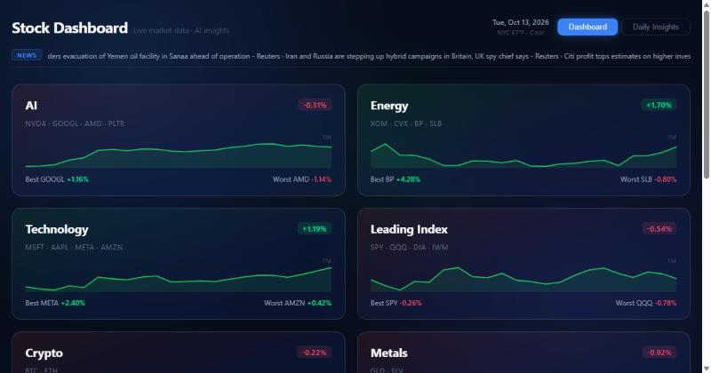
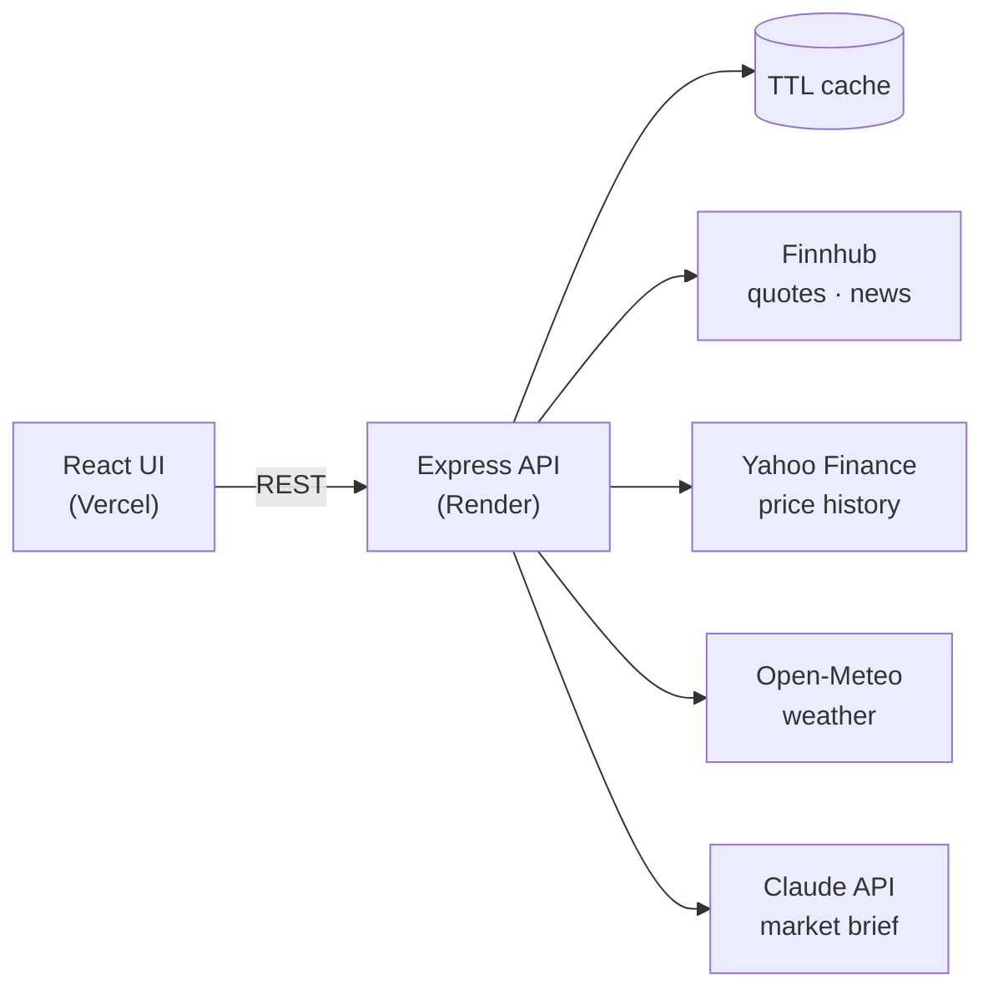

# Stock Dashboard

[](https://github.com/oraluf/Stock_Viewer/actions/workflows/ci.yml)

A live market dashboard covering six sectors (AI, Energy, Technology, Leading Index, Crypto, Metals), with real-time quotes, interactive charts, and a daily market brief written by Claude.

**Live demo → [stock-viewer-iota.vercel.app](https://stock-viewer-iota.vercel.app/)**



> The backend runs on Render's free tier. A scheduled GitHub Action keeps it awake, but if it was asleep the first load can take up to a minute — the page says so while it waits.

---

## Features

- **AI market brief** — Claude reads the day's sector moves and the latest headlines, and writes a short brief: what moved, what plausibly explains it, and what to watch. It is told to say so when no headline explains a move instead of inventing a cause.
- **Sector overview** — each sector card shows today's average move, best and worst ticker, and a one-month trend line.
- **Per-stock charts** — 1D / 1M / 1Y price history for every ticker.
- **Auto-refresh** — quotes refresh every minute, charts every five minutes, without reloading the page.
- **Report generator** — builds a sector-by-sector report for any past trading day.
- **Live context** — scrolling market headlines and current New York weather.

## Architecture



```
backend/src/
├── app.js                  Express entry point
├── routes/                 HTTP layer only — validation + status codes
├── services/               Business logic, caching, AI brief, reports
├── adapters/               One file per data provider (Finnhub, Yahoo)
├── config/stocks.js        Sectors & tickers — single source of truth
└── storage/                In-memory store
ui/src/
├── App.jsx                 Shell, routing between views, server wake-up handling
├── api.js                  Every call to the backend
└── components/             Sector cards, charts, AI brief, report generator, intro
```

## Engineering decisions

**Two market-data providers, chosen per job.** Finnhub's free tier provides live quotes and news but returns `403` for historical candles. Rather than paying for one provider or faking chart data, price history comes from Yahoo Finance through a second adapter with the same normalized output (`{ t, o, h, l, c, v }`). Services choose the adapter; routes never know which provider is behind them.

**The AI brief is cached and structured.** One Claude call serves every visitor for 30 minutes, and concurrent requests share a single in-flight call, so a traffic spike costs the same as one visit. The response is constrained to a JSON schema, so the UI renders fields directly instead of parsing free text. Refusals are handled explicitly, and if no API key is configured the panel is simply hidden.

**No fabricated data.** Earlier versions filled gaps with placeholders (random chart lines, demo headlines, fixed weather). Every one was replaced with real data or an honest "unavailable" state. When a background refresh fails, the last good value stays on screen.

**Built for a sleeping free-tier server.** The UI shows a wake-up notice after 3 seconds and retries the first request, and a scheduled workflow pings `/health` every 10 minutes.

**Rate-limit aware.** TTL caching per endpoint (quotes 30s, charts 5min, news 10min, weather 15min, brief 30min) keeps the app inside Finnhub's free-tier limit of 60 calls/minute.

## Tech stack

| Layer    | Technology |
|----------|------------|
| Frontend | React 18, Vite 6, Chart.js 4 |
| Backend  | Node.js 22, Express 4, Anthropic SDK |
| Data     | Finnhub, Yahoo Finance, Open-Meteo |
| AI       | Claude Opus 5.5 (structured outputs) |
| Testing  | Node's built-in test runner, GitHub Actions CI |
| Hosting  | Vercel (UI) + Render (API) |

---

## Run locally

Requires Node.js 18+ and a free [Finnhub API key](https://finnhub.io/register). An [Anthropic API key](https://console.anthropic.com) is optional and enables the AI brief.

```bash
# Backend
cd backend
cp ../.env.example .env      # add your keys
npm install
npm run dev                  # http://localhost:3001

# Frontend (second terminal)
cd ui
npm install
npm run dev                  # http://localhost:3000 — proxies API calls to :3001
```

Run the tests:

```bash
cd backend && npm test
```

## Environment variables

| Variable            | Where                | Purpose |
|---------------------|----------------------|---------|
| `FINNHUB_API_KEY`   | `backend/.env`, Render | Live quotes and news |
| `ANTHROPIC_API_KEY` | `backend/.env`, Render | AI market brief (optional) |
| `VITE_API_URL`      | Vercel               | Backend URL (leave empty for local dev) |

## API

| Method | Path | Description |
|--------|------|-------------|
| GET  | `/health` | Health check |
| GET  | `/config` | Sectors and tickers |
| GET  | `/overview` | Per-sector average move, best/worst ticker, 1-month trend |
| GET  | `/brief` | AI market brief (`503` when no Anthropic key is set) |
| GET  | `/quote?ticker=NVDA` | Live price and daily change |
| GET  | `/series?ticker=NVDA&range=1D` | Price history — `1D`, `1M` or `1Y` |
| GET  | `/news` | Latest market headlines |
| GET  | `/weather` | Current New York weather |
| GET  | `/report/daily` | Today's sector report |
| GET  | `/report/archive` | Reports generated since the server started |
| POST | `/report/generate` | Report for a given date — body `{ "date": "YYYY-MM-DD" }` |

## Deploy

**Backend → Render.** New Web Service from this repo; `render.yaml` sets the root directory and commands. Add `FINNHUB_API_KEY` and `ANTHROPIC_API_KEY` under Environment.

**Frontend → Vercel.** Import the repo; `vercel.json` sets the build. Add `VITE_API_URL` with the Render URL.
